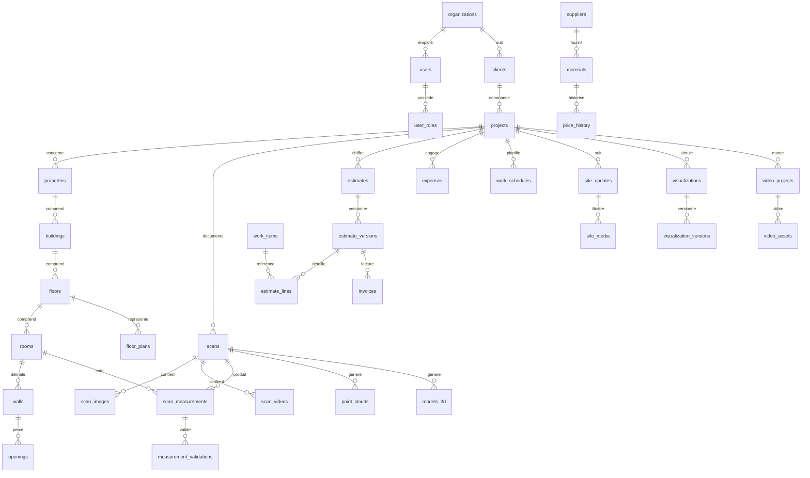

# Schéma de base de données — LAMAALAM

Version 0.1 — 1er novembre 2026 — statut : **PROPOSITION, à valider**

Base cible : **PostgreSQL** (version stable courante au moment de l'installation, ≥ 16). Le schéma est créé et migré exclusivement par **Alembic** ; ce document en est la spécification, la vérité exécutable sera `backend/migrations/`.

Le téléphone dispose d'un sous-ensemble de ces tables dans SQLite (Drift), limité aux projets téléchargés par l'utilisateur.

## 1. Conventions communes

Toutes les tables métier comportent :

| Colonne | Type | Rôle |
| --- | --- | --- |
| `id` | `uuid` PK | UUID v7 (ordonné dans le temps), généré par le client ou le serveur |
| `organization_id` | `uuid` NOT NULL FK → `organizations` | Isolation multi-organisation, filtrée par RLS |
| `created_at` | `timestamptz` NOT NULL | |
| `created_by` | `uuid` FK → `users` | |
| `updated_at` | `timestamptz` NOT NULL | |
| `updated_by` | `uuid` FK → `users` | |
| `version` | `integer` NOT NULL DEFAULT 1 | Verrouillage optimiste (synchronisation) |
| `deleted_at` | `timestamptz` NULL | Suppression logique |

Règles :

- **Montants** en `bigint` exprimés en centimes, accompagnés d'une colonne `currency` (`char(3)`, contrainte `IN ('MAD','EUR')`).
- **Longueurs** en `numeric(10,3)` mètres, **surfaces** en `numeric(12,3)` m², **volumes** en `numeric(12,3)` m³. Jamais de `float` pour une donnée métrée ou monétaire.
- **Unités** d'ouvrage : type énuméré `unit_t` = `m`, `m2`, `m3`, `kg`, `l`, `u`, `forfait`.
- **Index partiels** `WHERE deleted_at IS NULL` sur les colonnes de recherche usuelles.
- Les tables « filles » d'un projet portent aussi `project_id` (dénormalisé) pour filtrer l'accès client sans jointure profonde.
- **RLS** activée sur toutes les tables portant `organization_id` : `USING (organization_id = current_setting('app.org_id')::uuid)`. *État : active et forcée (`FORCE ROW LEVEL SECURITY`) sur `clients` et `projects` ; les tables d'identité (`users`, `auth_sessions`…) en sont exclues car la connexion doit retrouver un compte avant de connaître son organisation. Un superutilisateur PostgreSQL ignore toujours la RLS : l'API se connecte avec un rôle sans ce privilège.*
- Fichiers : jamais stockés en base. La base stocke le chemin interne, la taille, le type MIME et l'empreinte SHA-256 (table `files`).
- Suppression physique uniquement par la procédure d'effacement des données personnelles (voir `SECURITY.md`), journalisée.

## 2. Diagramme des relations principales

## 3. Tables

Pour alléger, les colonnes communes du §1 ne sont pas répétées.

### 3.1 Organisation et accès

**organizations** — l'entreprise (Groupe LAMAALAM ; le modèle permet plusieurs entités juridiques).
`legal_name`, `trade_name`, `ice` (`char(15)`, contrainte `~ '^\d{15}$'`), `if_number`, `rc`, `patente`, `cnss`, `address`, `city`, `country` (`char(2)`), `phone`, `email`, `logo_file_id` FK `files`, `default_currency`, `default_vat_rate_id` FK `tax_rates`, `estimate_validity_days`, `estimate_footer`. Pas de `organization_id` (table racine).

**users** — `email` (`citext`, UNIQUE), `password_hash` (Argon2id), `totp_secret_enc` (chiffré applicativement), `totp_enabled`, `full_name`, `phone`, `locale` (`fr`, `ar`), `status` (`invited`, `active`, `suspended`), `last_login_at`, `failed_login_count`, `locked_until`, `client_id` FK `clients` NULL (renseigné seulement pour un compte client).
Index : UNIQUE `(email)`.

**user_roles** — `user_id` FK, `role` (`admin`, `collaborator`, `client`), `scope_project_id` FK `projects` NULL (restriction d'un collaborateur à certains projets).
Contrainte : UNIQUE `(user_id, role, scope_project_id)`. Contrainte applicative : un utilisateur `client` ne peut cumuler aucun autre rôle.

*Tables techniques ajoutées* :

- **auth_sessions** — `user_id`, `refresh_token_hash`, `device_label`, `ip`, `user_agent`, `expires_at`, `revoked_at`. Index `(user_id) WHERE revoked_at IS NULL`.
- **invitations** — `email`, `role`, `client_id` NULL, `token_hash`, `expires_at`, `accepted_at`.
- **files** — `storage_key`, `mime_type`, `size_bytes`, `sha256`, `width`, `height`, `duration_s`, `captured_at`, `project_id` NULL, `visibility` (`internal`, `client_shared`) DEFAULT `internal`.
- **tax_rates** — `label`, `rate_bp` (taux en points de base, 2000 = 20 %), `valid_from`, `valid_to`, `country`.
- **sync_cursors** — `user_id`, `device_id`, `last_server_version` (synchronisation incrémentale).

### 3.2 Clients et projets

**clients** *(créée, migration 0003)* — `type` (`individual`, `company`), `display_name`, `ice`, `phone`, `email`, `address`, `city`, `notes`, `consent_at` (consentement loi 09-08 / RGPD), `consent_text_version`, `sync_seq`. Les champs `first_name`, `last_name`, `company_name` initialement prévus sont remplacés par le seul `display_name` (nom ou raison sociale) : à redécouper si les devis l'exigent.
Index : `(organization_id, display_name)`, trigramme sur `display_name` pour la recherche (extension `pg_trgm`).

**projects** *(créée, migration 0003 ; valeurs énumérées stockées en texte avec contrainte CHECK, plus simples à faire évoluer que des types PostgreSQL ; `client_id` provisoirement facultatif pour reprendre les projets Qiyas sans client ; latitude et longitude pas encore créées)* — `reference` (UNIQUE par organisation, ex. `LMA-2026-0042`, attribuée par le serveur avec le préfixe `organizations.reference_prefix` et la table `org_counters`), `client_id` FK, `name`, `project_type` (`renovation`, `new_build`, `extension`, `interior`, `exterior`, `commercial`), `property_kind` (`apartment`, `house`, `villa`, `land`, `commercial`), `status` (`prospect`, `visit_planned`, `estimating`, `estimate_sent`, `won`, `in_progress`, `delivered`, `lost`, `archived`), `description`, `budget_cents`, `currency`, `visit_date`, `manager_id` FK `users`, `site_address`, `site_city`, `latitude`, `longitude`, `notes`.
Index : UNIQUE `(organization_id, reference)`, `(organization_id, status)`, `(client_id)`.

> `project_type` et `property_kind` sont séparés : le cahier des charges mélange dans une même liste la nature des travaux (rénovation, extension…) et la nature du bien (appartement, villa, terrain…).

**properties** — le bien : `project_id` FK, `kind`, `address`, `cadastral_ref`, `land_area_m2`, `built_area_m2`, `year_built`, `notes`.

**buildings** — `property_id` FK, `name` (ex. « Bâtiment principal »), `levels_count`.

**floors** — `building_id` FK, `project_id`, `name`, `level_index` (entier, 0 = RDC, négatif = sous-sol), `elevation_m`.

**rooms** — `floor_id` FK, `project_id`, `name`, `room_type` (`room`, `corridor`, `bathroom`, `kitchen`, `facade`, `roof`, `stairs`, `terrace`, `land`, `other`), `ceiling_height_m`, `polygon` (`jsonb` : sommets `[x, y]` en mètres dans le repère de l'étage, **dérivés** des murs), `computed_floor_area_m2`, `computed_perimeter_m`, `computed_at`, `calc_version` (version de la bibliothèque de calcul utilisée).
Les valeurs `computed_*` sont des **caches** recalculables, jamais saisies.

*État au lot 1.3 (migration 0004)* : **la table `rooms` est créée, rattachée directement au projet** (`project_id`, `level_name` texte) ; `properties`, `buildings` et `floors` ne sont pas encore créées. **Murs et ouvertures sont stockés en JSONB dans la fiche de la pièce** (`walls`, `openings`) plutôt que dans des tables `walls` et `openings` : la pièce est l'unité de synchronisation et de conflit, et un relevé incohérent ne peut ainsi jamais être enregistré à moitié. Le serveur valide la structure (3 à 64 murs, ouvertures sur des murs existants, plages de valeurs) et recalcule `computed_floor_area_m2`, `computed_perimeter_m` et `closure_error_m` à chaque écriture. Les tables ci-dessous restent la cible si des requêtes mur par mur deviennent nécessaires.

*Tables ajoutées pour sortir du modèle rectangulaire (cible)* :

- **walls** — `room_id`, `project_id`, `index` (ordre de parcours), `length_m`, `angle_to_next_deg` (DEFAULT 90), `height_m` NULL (hérite de la pièce), `thickness_m`, `finish`. **Les murs sont la source** ; le polygone de la pièce en est déduit. Si le polygone ne se referme pas (écart de fermeture > 2 cm), la pièce est signalée « cotes incohérentes » et son métré ne peut pas être validé.
- **openings** — `wall_id`, `project_id`, `type` (`door`, `window`, `bay`, `closet`, `other`), `width_m`, `height_m`, `sill_height_m`, `offset_from_start_m`, `is_default_size` (bool : vrai si dimension standard non mesurée).

### 3.3 Scans et mesures

**scans** — `project_id`, `room_id` NULL, `target` (`room`, `corridor`, `facade`, `roof`, `stairs`, `terrace`, `land`, `structure`), `mode` (`photo`, `video`, `assisted`), `status` (`capturing`, `uploading`, `queued`, `processing`, `done`, `failed`, `rejected`), `failure_reason`, `device_model`, `has_depth_sensor`, `reference_measurement_id` FK `scan_measurements` NULL, `quality_report` (`jsonb` : images recalées, erreur de reprojection, couverture, contrôle d'échelle), `usable_for_metre` (bool, calculé selon seuils).

**scan_images** — `scan_id`, `project_id`, `file_id`, `sequence`, `sharpness_score`, `exposure_score`, `is_duplicate`, `is_keyframe`, `from_video_id` NULL, `registered` (recalée par SfM), `camera_params` (`jsonb`).

**scan_videos** — `scan_id`, `project_id`, `file_id`, `duration_s`, `fps`, `resolution`, `keyframes_extracted`.

**scan_measurements** — `project_id`, `scan_id` NULL, `room_id` NULL, `wall_id` NULL, `opening_id` NULL, `kind` (`length`, `width`, `height`, `thickness`, `opening_width`, `opening_height`, `angle`, `distance`), `value` `numeric(10,3)`, `unit` (`m`, `deg`), `source` (`manual_tape`, `laser_meter`, `photogrammetry`, `ar_session`, `default_value`), `status` (`estimated`, `calibrated`, `verified`), `confidence` `numeric(3,2)` CHECK 0–1, `uncertainty_m`, `supersedes_id` FK `scan_measurements` NULL (historique des corrections).
Contrainte : au moins un des rattachements (`room_id`, `wall_id`, `opening_id`) non nul. Une correction **crée** une nouvelle ligne et marque l'ancienne comme remplacée ; aucune mise à jour en place.

**measurement_validations** — `project_id`, `room_id` NULL, `scope` (`measurement`, `room`, `metre`), `measurement_id` NULL, `validated_by`, `validated_at`, `unverified_ids` (`uuid[]` : cotes non vérifiées acceptées explicitement), `comment`.

**point_clouds** — `scan_id`, `project_id`, `file_id`, `format` (`ply`), `points_count`, `is_dense`, `scale_factor`, `scale_source_measurement_id`, `bbox` (`jsonb`).

**models_3d** *(nommée `3d_models` dans le cahier des charges ; renommée car un identifiant SQL ne peut commencer par un chiffre sans guillemets)* — `project_id`, `scan_id` NULL, `source` (`reconstruction`, `parametric`, `import`), `file_id`, `format` (`obj`, `ply`, `glb`), `triangles_count`, `textured`, `parent_id` NULL.

**floor_plans** — `project_id`, `floor_id`, `version_no`, `source` (`manual`, `scan`, `mixed`), `geometry` (`jsonb` : pièces, murs, ouvertures, mobilier, cotes), `export_pdf_file_id`, `export_png_file_id`, `is_current`.
Index : UNIQUE `(floor_id, version_no)`.

### 3.4 Bibliothèque, prix, ouvrages

**suppliers** *(créée, migration 0005 ; `materials`, `work_items` et `price_history` aussi, avec RLS ; `price_history` en insertion seule par déclencheur et alimentée par le serveur à chaque changement de prix ; `rooms.counts` et `projects.metre_validation` ajoutées)* — `name`, `contact_name`, `phone`, `email`, `address`, `city`, `ice`, `notes`.

**materials** — `supplier_id` NULL, `category` (`floor`, `wall`, `ceiling`, `joinery`, `electricity`, `plumbing`, `masonry`, `other`), `name`, `brand`, `reference`, `unit`, `pack_size` (ex. 1,44 m² par carton), `default_waste_rate_bp` (points de base, DEFAULT 0), `current_purchase_price_cents` NULL, `current_sale_price_cents` NULL, `currency`, `city`, `price_updated_at`, `texture_file_id` NULL.
Prix NULL = **prix non renseigné** : la ligne de devis correspondante est bloquée tant qu'un prix n'est pas saisi.

**price_history** — `material_id` NULL, `work_item_id` NULL, `purchase_price_cents`, `sale_price_cents`, `currency`, `supplier_id`, `city`, `valid_from`, `source_note` (devis fournisseur n°…, facture…). Insertion seule, jamais modifiée.

**work_items** — ouvrage élémentaire de la bibliothèque : `code`, `category`, `name`, `description`, `unit`, `quantity_basis` (`floor_area`, `ceiling_area`, `wall_net_area`, `wall_gross_area`, `skirting_length`, `perimeter`, `volume`, `opening_count`, `manual`), `waste_rate_bp` DEFAULT 0, `labour_cost_cents` NULL, `labour_hours_per_unit` NULL, `components` (`jsonb` : `[{material_id, quantity_per_unit}]`), `sale_price_cents` NULL, `currency`, `is_active`.

*Tables ajoutées* : **estimate_templates** (modèles de devis : liste ordonnée de `work_items`), **architectural_styles** (styles de visualisation), **library_assets** (textures, modèles 3D de mobilier, photos de référence, avec `license` et `source_url` obligatoires).

### 3.5 Devis, factures, dépenses

**estimates** — le dossier de devis : `project_id`, `reference` (UNIQUE par organisation, numérotation attribuée **par le serveur** pour garantir la continuité), `title`, `current_version_id` FK `estimate_versions`.

**estimate_versions** — `estimate_id`, `project_id`, `version_no`, `status` (`draft`, `validated`, `sent`, `accepted`, `refused`, `superseded`), `currency`, `exchange_rate` NULL, `exchange_rate_date`, `exchange_rate_source`, `issue_date`, `validity_days`, `discount_bp`, `overhead_bp` (frais indirects), `margin_bp`, `deposit_bp`, `subtotal_cents`, `discount_cents`, `total_ht_cents`, `total_vat_cents`, `total_ttc_cents`, `metre_validation_id` FK `measurement_validations`, `pdf_file_id`, `validated_by`, `validated_at`, `sent_at`, `decided_at`, `decision_note`, `calc_version`.
Contraintes : UNIQUE `(estimate_id, version_no)` ; trigger refusant toute modification d'une version dont le statut n'est pas `draft` (sauf transition de statut autorisée).

**estimate_lines** — `estimate_version_id`, `project_id`, `position`, `section` (lot : sols, murs…), `work_item_id` NULL, `room_id` NULL, `label`, `description`, `unit`, `quantity_basis`, `net_quantity`, `waste_rate_bp`, `ordered_quantity`, `quantity_overridden` (bool) et `quantity_override_reason`, `material_cost_cents`, `labour_cost_cents`, `pricing_method` (`cost_plus`, `direct_sale`), `unit_price_cents`, `vat_rate_bp`, `line_total_ht_cents`, `trace` (`jsonb` : pièces, cotes et formules ayant produit la quantité).

**invoices** — `project_id`, `estimate_version_id` NULL, `reference` (numérotation continue, attribuée par le serveur), `type` (`deposit`, `progress`, `final`, `credit_note`), `issue_date`, `due_date`, `currency`, totaux, `status` (`draft`, `issued`, `paid`, `cancelled`), `pdf_file_id`. *Les mentions légales et la conformité à la facturation électronique marocaine sont à valider par un expert-comptable avant usage.*

**expenses** — `project_id`, `category` (`material`, `labour`, `subcontract`, `rental`, `transport`, `other`), `supplier_id` NULL, `amount_cents`, `currency`, `vat_cents`, `spent_on`, `receipt_file_id`, `description`.

### 3.6 Chantier

**work_schedules** — `project_id`, `title`, `starts_on`, `ends_on`, `week_index`, `lot`, `status` (`planned`, `in_progress`, `done`, `late`), `progress_pct` CHECK 0–100, `assignee_id`.

**site_updates** — `project_id`, `occurred_at`, `kind` (`progress`, `incident`, `change`, `material_used`, `task_done`, `comment`), `title`, `body`, `visible_to_client` (bool, DEFAULT false), `schedule_id` NULL.

**site_media** — `site_update_id`, `project_id`, `file_id`, `phase` (`before`, `during`, `after`), `caption`, `visible_to_client` DEFAULT false, `taken_at`.

### 3.7 Visualisation et vidéo

**visualizations** — `project_id`, `room_id` NULL, `title`, `style_id` FK `architectural_styles`, `base_file_id` (photo ou scan de référence), `model_3d_id` NULL.

**visualization_versions** — `visualization_id`, `project_id`, `version_no`, `level` (`preview`, `detailed`, `photoreal`), `parameters` (`jsonb` : matériaux, couleurs, éclairage, mobilier), `engine` (`blender`, `ai_model`), `engine_version`, `model_name` NULL, `status`, `output_file_id`, `is_simulation` NOT NULL DEFAULT true, `visible_to_client` DEFAULT false.

**video_projects** — `project_id`, `title`, `aspect` (`9:16`, `1:1`, `16:9`), `template`, `status` (`draft`, `rendering`, `ready`, `approved`, `failed`), `timeline` (`jsonb`), `output_file_id`, `approved_by`, `approved_at`, `visible_to_client` DEFAULT false.

**video_assets** — `video_project_id`, `project_id`, `file_id`, `role` (`before`, `during`, `after`, `logo`, `music`, `title_card`), `position`, `in_s`, `out_s`, `license_note` (obligatoire pour `music`).

### 3.8 Communication et traçabilité

**notifications** — `user_id`, `kind`, `title`, `body`, `project_id` NULL, `read_at`.

**messages** — `project_id`, `author_id`, `body`, `attachment_file_id` NULL, `read_by` (`uuid[]`). Fil unique par projet entre le client et l'équipe.

**audit_logs** — `occurred_at`, `actor_id` NULL, `actor_role`, `action` (ex. `estimate.validate`, `user.role.change`, `file.download`, `data.export`, `data.erase`), `entity_table`, `entity_id`, `project_id` NULL, `ip`, `details` (`jsonb`, sans donnée sensible en clair).
Insertion seule : le rôle applicatif PostgreSQL n'a ni `UPDATE` ni `DELETE` sur cette table. Partitionnement mensuel par `occurred_at`. Pas de `version`, `deleted_at`, ni `updated_*`.

## 4. Règles d'accès par rôle (appliquées par l'API et la RLS)

| Table | Administrateur | Collaborateur | Client |
| --- | --- | --- | --- |
| organizations, users, user_roles, tax_rates | lecture/écriture | lecture de son profil | lecture de son profil |
| clients | tout | lecture/écriture sur ses projets | sa propre fiche |
| projects et tables filles | tout | projets dont il est responsable ou membre | lecture de ses projets, uniquement les lignes `visible_to_client` ou les devis `sent`/`accepted`/`refused` |
| materials, suppliers, price_history, work_items | tout | lecture (prix d'achat masqués selon paramètre) | aucun accès |
| estimate_lines (déboursés, marges) | tout | lecture/écriture brouillon | **jamais** : le client ne voit que le PDF et les totaux |
| expenses | tout | création sur ses chantiers | aucun accès |
| audit_logs | lecture | aucun | aucun |

## 5. Historique et versions

- Devis, plans et visualisations : versions explicites (`*_versions`, `version_no`), une version figée n'est jamais modifiée.
- Mesures : chaîne `supersedes_id`.
- Prix : `price_history` en insertion seule.
- Autres tables : `audit_logs` + `version` pour la synchronisation.
